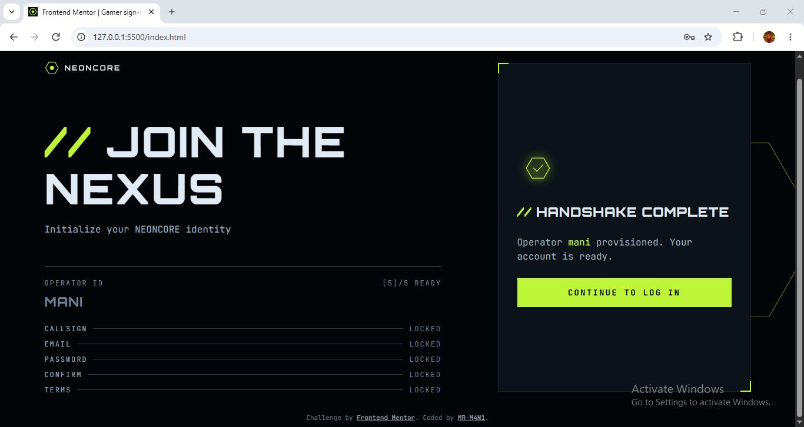
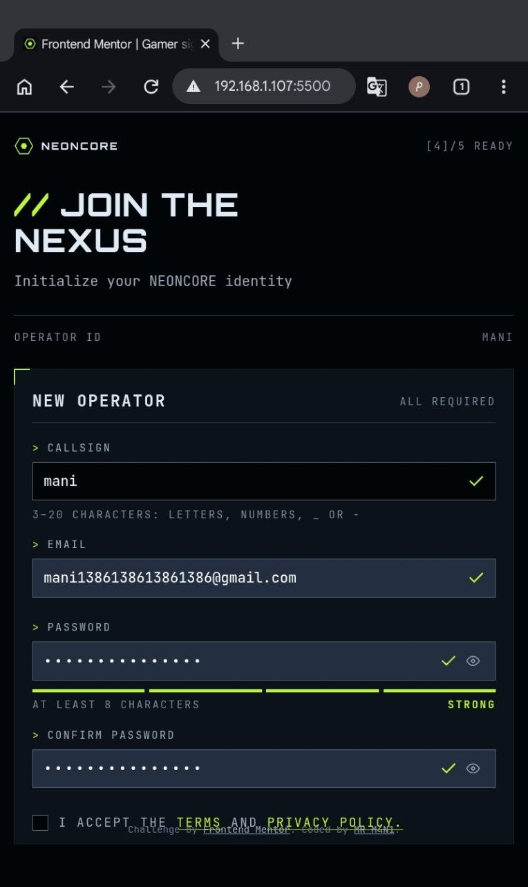
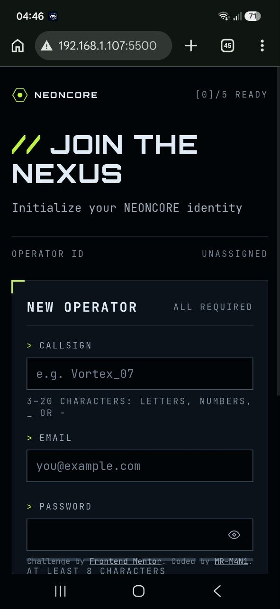

# Gamer-sign-up-form
This is a my solution to the Gamer sign-up form challenge on Frontend Mentor
# Frontend Mentor - Gamer sign-up form solution

This is a solution to the [Gamer sign-up form challenge on Frontend Mentor](https://www.frontendmentor.io/challenges/gamer-sign-up-form). Frontend Mentor challenges help you improve your coding skills by building realistic projects. 

## Table of contents

- [Overview](#overview)
  - [The challenge](#the-challenge)
  - [Screenshot](#screenshot)
  - [Links](#links)
- [My process](#my-process)
  - [Built with](#built-with)
  - [What I learned](#what-i-learned)
  - [Continued development](#continued-development)
  - [Useful resources](#useful-resources)
  - [AI Collaboration](#ai-collaboration)
- [Author](#author)
- [Acknowledgments](#acknowledgments)

## Overview

### The challenge

Users should be able to:

- Fill in the form with a callsign, email, password, and password confirmation, and accept the terms
- Receive form validation messages if any field is missed or filled in incorrectly
- Show and hide each password with the eye button
- See a password strength meter update as they type
- See a loading state on the button while the form submits, then a success message
- Complete the form only using their keyboard
- Have inputs, hints, error messages, and the success message announced on their screen reader
- View the optimal layout for the interface depending on their device's screen size
- See hover and focus states for all interactive elements on the page

### Screenshot






### Links

- Solution URL: [Frontend Mentor Solution](https://your-solution-url.com)
- Live Site URL: [Live Demo](https://your-live-site-url.com)

## My process


### Built with

- Semantic HTML5
- CSS3
- CSS Grid
- Flexbox
- Responsive Web Design
- CSS Media Queries
- CSS Custom Properties
- CSS Functions (clamp(), min())
- CSS Pseudo-elements & Pseudo-classes
- CSS Transitions
- Custom Variable Fonts (@font-face)
- JavaScript (ES6+)
- DOM Manipulation
- Event Handling
- Client-Side Form Validation
- Password Strength Indicator
- Dynamic Form Progress Tracking
- Password Visibility Toggle
- HTML Accessibility Attributes (ARIA)
- Reduced Motion Support (prefers-reduced-motion)

### What I learned

1.HTML Attributes & CSS Attribute Selectors: Learned how to use HTML attributes to control element behavior and how to target elements based on their attributes using CSS selectors such as [hidden], [aria-invalid="true"], and :not().

```css
.inputContainer input[aria-invalid="true"] {
    border-color: var(--Red-400);
}

[hidden] {
    display: none !important;
}
```

2.Toggle Functionality: Learned how toggle controls switch between two states. I applied this concept to password visibility, changing the input type, eye icon, and accessibility attributes whenever the user clicks the toggle button.

```js
const shouldShow = controlledInput.type === "password";

controlledInput.type = shouldShow ? "text" : "password";

toggle.setAttribute(
    "aria-pressed",
    String(shouldShow)
);
```

### Continued development

I plan to improve my workflow by collaborating more actively with AI tools throughout the development process. My goal is to use AI to increase both development speed and code quality, get feedback on my implementations, explore better solutions, and continuously improve my problem-solving skills.

I also want to become better at using AI as a development assistant while maintaining a strong understanding of the code I write.

### Useful resources

---------

### AI Collaboration

I used **ChatGPT** as my AI development assistant throughout this project.

Rather than simply asking AI to generate code, I focused on writing more specific and structured prompts by providing relevant code snippets, explaining the problems I encountered, and clearly describing the behavior I wanted to achieve.

I used ChatGPT to:

- Understand unfamiliar HTML, CSS, and JavaScript concepts.
- Debug issues and explore possible solutions.
- Review specific parts of my code and identify potential improvements.
- Learn about accessibility, ARIA attributes, and responsive design.
- Refine my implementation while maintaining control over my own code.

One of my biggest takeaways was learning that the quality of AI assistance depends heavily on how clearly I communicate my goals, provide context, and ask questions.

This project helped me become more confident in collaborating with AI while improving my own problem-solving and prompting skills.

## Author

- Frontend Mentor - [@MR-M4N1](https://www.frontendmentor.io/profile/MR-M4N1)
- Pinterest - [@MR-M4N1](https://www.pinterest.com/mrm4n1/?invite_code=4dc73b0e43814c3395c2f9600625eb5d&sender=1093671228168293050)
- LinkedIn - [@mani-ghorbanian](https://www.linkedin.com/in/mani-ghorbanian-351820327/)

## Acknowledgments

Thanks to Frontend Mentor for providing this challenge and the design resources that helped guide my implementation.
